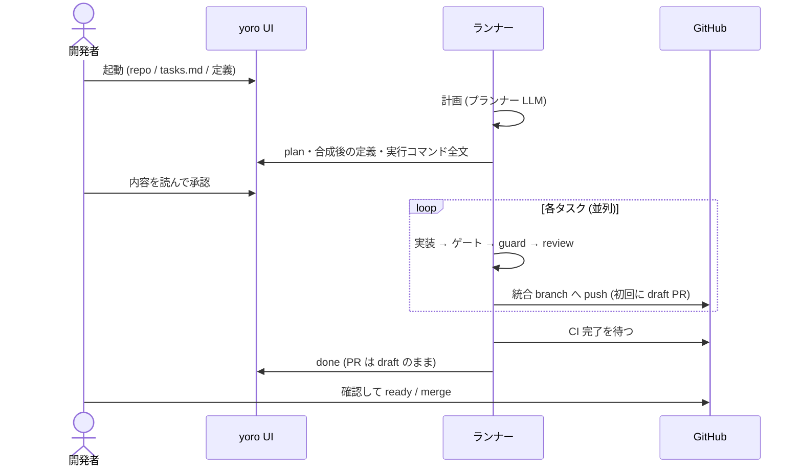
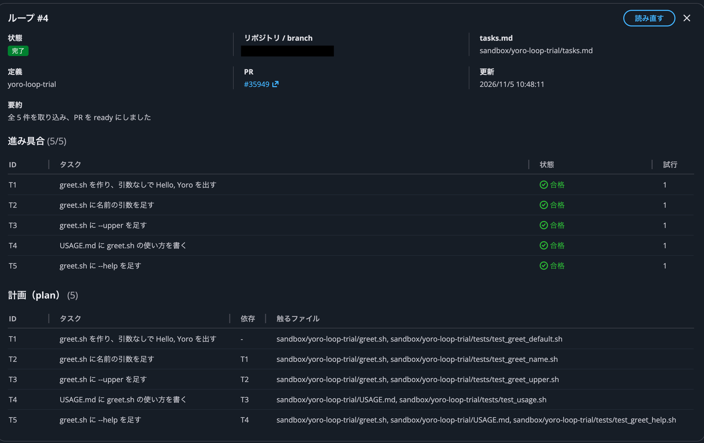

みなさん、おはようございます、こんにちは、こんばんは Ai Workforce 事業部 プロダクト部 Platform Enablement グループ 吉井 亮です。
テクニカルプロジェクトマネージャーというロールで日々プロダクトの価値向上に邁進しています。

当記事では Ai Workforce 事業部のリモートコーディングエージェント環境である `yoro` を使ったループエンジニアリングを紹介します。

## 前置き

突然ですが、私は SDD (スペック駆動開発) がお気に入りです。理由は2つです。
1つ目、LLM は会話を忘れるということです。テクノロジーやハードウェアの進化で改善していますが、無限に会話は記録できません。これは仕方がないことで受け入れています。SDD で徹底したドキュメント化をすることにより、もし忘れても LLM はすぐに思い出し、正しい行動へ移れます。
2つ目、人間も忘れます。数年前の人間がタスクを100%実行した頃なら自分のタスクを把握しておくことは難しくありません。ただ、現代は違います。エージェントが高度なタスクを短時間でこなし、複数のタスクを同時に完了していく今日では、人間が全てのタスクを管理することは無理があり非効率でもあります。SDD は進捗やタスクリストがドキュメント化されるので、振り返って思い出すことが可能です。

SDD には複数のフェーズが存在します。グラウンドルール作成、要件定義、仕様書作成、計画作成、タスクリスト作成、実装、テスト、完了確認。さらにフェーズ間には網羅性チェック、完全性チェックなどのレビュープロセスが入ります。これら1つ1つがそれなりに時間を要します。
ローカル PC で LLM を使い、これらを実行していたわけですが、やむを得ず PC を閉じなければならない状況が稀にあり、その場合、作業が中断してしまいます。PC を開いた際に LLM はそれまで完了していたところまで戻り再開はするのですが、時間とトークンの無駄です。トークンは貴重です。

## 本題

前置きは終わりです。
長い作業の場合はリモートコーディングエージェント `yoro` を使います。

## yoro

`yoro` は弊事業部の SREs が作成し、皆で機能拡張しているリモートコーディングエージェント環境です。
詳しくは以下のブログを参照ください。

https://zenn.dev/layerx/articles/a277f83a93d300

簡単に説明すると、

- **いろいろな場所から頼める**：Slack の`:yoro:`、ターミナル、Ai Workforce のタスク、GitHub のレビュー依頼などから作業を始められる。
- **手元のPCを閉じても作業が続く**：エージェントは本人専用の Coder ワークスペースで動く。計画、実装、プレビューでの確認、PR作成まで進める。
- **自動で動かすための隔離と監視**：コマンドごとの許可待ちを省く代わりに、ワークスペースを VM で隔離し、通信先を制限。実行状況も記録する。
- **社内の仕組みと連携できる**：Ai Workforce のタスクに PR や結果を返したり、プレビュー環境で動作確認したりできる。自社運用なので、連携先や動きを柔軟に作れる。

まさしくリモートで頑張ってくれるエージェントです。`yoro` は影響範囲を限定された隔離環境、かつ、再作成が容易な環境で、エージェントによる承認なし自動実行に最適です。これなら長い作業も任せておけます。

## yoro Loop

このように便利な `yoro` にループエンジニアリングを実践する機能を追加しました。
`yoro Loop` を説明する前にループとは何でしょうか？
Claude のドキュメントには以下のように記されています。

> On the Claude Code team, we define loops as agents repeating cycles of work until a stop condition is met.
> 
> (筆者による日本語訳)
> Claude Code チームでは、ループを停止条件が満たされるまで作業サイクルを繰り返すエージェントと定義しています。

*https://claude.com/ja/resources/articles/getting-started-with-loops より引用*

「停止条件が満たされるまで作業サイクルを繰り返す」、これが欲しかった機能です。Claude のドキュメントを参考にしながら `yoro Loop` を設計しました。
SDD で作成した要件定義、仕様書、設計書、テストファイル、タスクリストの通り確実に実装するエージェントが欲しかったのです。しかも自動的に。
`yoro Loop` は、開発者が tasks.md を渡すと、その中身を AI が上から順に実装し、最後にドラフトの Pull Request を1本出すまでを自律的に回す仕組みです。

1. 起動と計画の承認
    1. 開発者は yoro UI からリポジトリ、tasks.md、ループの定義を指定して起動する。ランナーはプランナー LLM を使い、tasks.md をタスク間の依存関係付きの計画に変換する。計画と実行するコマンドの全文は UI に表示される。開発者が内容を読んで承認するまで、実装は始まらない。
2. 自律実行
    1. 承認後、ランナーは依存の満たされたタスクを並列に worker へ渡す。worker はタスクごとに新しいコンテキストと使い捨ての作業ツリーで、実装、必須ゲート、guard、別モデルによるレビューの順に進める。合格した変更だけが統合 branch に取り込まれ、最初の取り込み時にドラフト PR が作られる。試行回数が上限に達すると、黙って次へ進まずに blocked で止まり、開発者へ知らせる。止まっても取り込み済みの成果は失われず、「再開」で続きから進められる。
3. 完了と最終判断
    1. 全タスクが終わると、ランナーは CI の完了を待ち、done を返す。PR はドラフトのまま残る。内容を確認して ready にするのも、merge するのも開発者である。




### yoro Loop tasks.md

`tasks.md` にタスクリストを定義します。ループの中身だと思ってください。
リスト形式でもチェックボックス形式でもなんでも構いません。LLM が読めれば OK です。
実業務で使った例を示すわけにはいかないので、テストで使った `tasks.md` を載せておきます。

```markdown:tasks.md 例
# yoro Loop 試験用のタスク

`sandbox/yoro-loop-trial/` の中だけを変更する。各タスクでテストを `tests/test_<名前>.sh` に足し、`check.sh` が通る状態にする。

## 段階 1: 挨拶のスクリプト

1. `greet.sh` を作る。引数なしで実行すると `Hello, yoro` を 1 行出す。`tests/test_greet_default.sh` で確かめる。
2. `greet.sh` に名前の引数を足す。`./greet.sh Alice` で `Hello, Alice` を出す。引数なしの動きは変えない。（1 の後）
3. `greet.sh` に `--upper` を足す。挨拶の全体を大文字で出す（`./greet.sh --upper Alice` で `HELLO, ALICE`）。（2 の後）

## 段階 2: 説明

4. `USAGE.md` に `greet.sh` の使い方（引数とオプション）を書く。テストは `USAGE.md` に `--upper` の説明があることを確かめる。（3 の後）
5. `greet.sh` に `--help` を足し、`USAGE.md` と同じ内容の要約を出す。（4 の後）
```

例はリスト形式ですが、私はどこまで終わったかを把握したいのでチェックボックス形式を使うことが多いです。実業務でのタスク数は50以上になります。

### yoro Loop 定義ファイル

定義ファイルでは、モデルや並列数のほか、タスクごとの工程、失敗時の扱い、予算、検証条件などを設定できます。ここでは、安全性に関わる設定をいくつか紹介します。  
計画の承認後はタスクを自動で実行するため、想定外の変更や長時間の実行を防ぐガードレールと、問題が起きたときに処理を止めるストッパーを設けています。たとえば、ループ全体とタスクごとに実行時間の上限を設け、`protected` で編集できないパスを指定します。また、`required_gates` に指定したコマンドが成功しない場合は変更を統合せず、失敗時の試行回数が上限に達した場合は処理を止めて開発者に知らせます。
以下は設定例の一部です。実行時間の上限設定は省略しています。

```yaml
name: team-default
kind: tasks
extends: default
description: "実装 → テスト → 必須ゲートで 1 タスクずつ取り込む"
planner: { agent: claude, model: claude-opus-5-5 } 
on_fail: { retry_from: implement, max_attempts: 3, then: block }       # 3 回で止めて人へ知らせる
per_task:
  - { id: implement, type: agent,   agent: claude, prompt_file: .yoro/prompts/implement.md }
  - { id: test,      type: command, run: "make test" }
required_gates:            # 取り込み前に必ず実行（空だと開始できない）
  - "make check"
protected:                 # ループ中のエージェントが変更できないパス
  - ".github/workflows/**"
context:                   # プランナーと実装役に渡す資料
  - docs/spec.md
  - docs/required.md
```
デフォルト設定を用意しているので定義ファイルを作るのが面倒なケースではデフォルトを使います。

### yoro Loop 画面サンプル

上で示した `tasks.md` をループさせた際のスクリーンショットです。 `yoro Loop` が計画を作り、進捗している様子が見てとれます。
これは完了後のスクリーンショットですが、進行中はどこまで進んでいるか分かりますし、どこで失敗したかも分かります。最新版ではこの横にチャット欄がありまして、失敗時にファイルの修正を指示し、再開させることが可能です。



### yoro 実績

私がある機能を実装させたところ以下の通りでした。

- **タスク数:** 40
- **yoro Loop が書いた行数:** 実装・テスト・文書で +6,689 / −71 行
- **所要時間:** 約 167 分（2 時間 47 分）
- **ループ後に人間が直した分量:** 10 コミット、延べで +1,978 / −335 行

タスクはシリアルで流しました。パラレルにしたらもう少し短くなると考えています。
ループのなかでセルフレビューを最大5周回しているのですが、それでも人間が直す分量は多いですね。ここは課題です。Spec に対するテストの記述が甘かったのかもしれません。

## yoro Loop の優れている点

`yoro Loop` は以下の点で優れています。

- **タスクごとに新しいコンテキスト:** 1 タスク 1 worker で、会話が tasks.md 全体ぶん膨らまない。
- **外側から強制する検証:** 完了は exit code で決め、AI の「終わった」という自己申告に頼らない。作る役と確かめる役にも別のモデルを割り当てられる。
- **取り込める変更の制限:** ゲートを通った変更だけが統合 branch に入る。ゲートと保護パスはエージェントから書き換えられず、書き換えても実行中の設定には効かない。
- **必ず止まる:** 試行は上限で止まり、blocked で人へ知らせる。黙って次のタスクへ進まない。
- **状態をディスクに持つ:** state.json を統合 branch に commit する。中断しても取り込み済みを失わず、「再開」で続きから進む。
- **人の承認が起点:** 計画、実行するコマンド全文、予算を読んで承認してから動く。起動・承認・再開は人だけで、AI や Slack の文面からは進められない。
- **成果物は 1 本の draft PR:** レビュー、最終修正、merge は人が行う。
- **定義ファイルで回し方を変えられる:** 層ごとに上書きでき、ゲートや保護パスのような安全の下限は緩められない。

タスクごとに新しいコンテキストで実装するため、コンテキスト肥大化の心配はありません。
人間が用意したゲートを必ず通すことで品質を担保しています。PR は draft にしたり、エラー時の再試行回数を制限したりと、「自由にやらせない」仕組みも入れています。

## まとめ

バブル期の TV CM に「24時間戦えますか。」というものがありました。私は24時間働くことができませんが、リモートコーディングエージェント `yoro` は24時間働いてくれます（リソース費用は発生しますが……）。
すべてのタスクをリモートコーディングエージェントによるループに委託することはできません。向き不向きは見極めるべきだと考えます。アウトプットの質もまだまだ改善していかなければなりません。これはループを回す人間の問題です。それらを乗り越えてうまく使いこなすことで働き方が一段階レベルアップすることは間違いないでしょう。

## 参考

[Loop Engineering](https://addyosmani.com/blog/loop-engineering/)  
[Loop engineering: Getting started with loops](https://claude.com/ja/resources/articles/getting-started-with-loops)  

## おわりに

LayerX では、ループエンジニアリングを駆使して一緒に課題を解決する仲間を募集しています！
少しでも興味を持っていただけたら、まずはカジュアルにお話ししませんか？

https://jobs.layerx.co.jp/opendoor/?service=AI%E3%83%BBLLM


また、テクニカルプロジェクトマネージャーに興味がある方も募集しています。
技術的な責任を持つ楽しいロールです。以下の記事も参照ください。

https://note.layerx.co.jp/n/n22415550ce91

https://open.talentio.com/r/1/c/layerx/pages/107242


